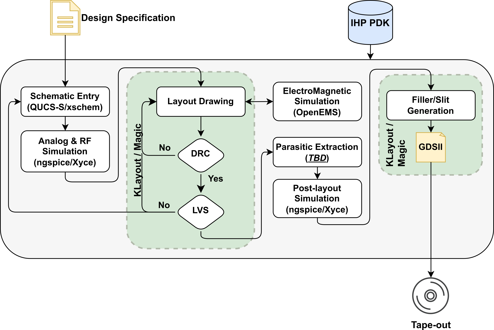

Design using Qucs-S
=====================================
Qucs-S (Quite Universal Circuit Simulator - SPICE) is a fork of the Qucs 
project that integrates SPICE simulation capabilities. Unlike the original
Qucs, which uses its own solver, Qucs-S allows users to simulate circuits using
a variety of SPICE engines like Ngspice, XYCE, or any other SPICE-compatible 
simulator. This makes it versatile for both analog and digital circuit 
simulation. Qucs-S maintains the same graphical user interface (GUI) as Qucs,
enabling schematic capture, simulation, and waveform viewing in a user-friendly 
environment, but with the added flexibility of SPICE simulation. Qucs-S has 
also a "look & feel" like a proprietary Keysight ADS tool.  

Since 2025 we use a dedicated branch, hosted 
`on qucs repository  <https://github.com/ra3xdh/qucs_s/tree/dev/xml_devices>`_ to 
integrate and maintain Qucs-S with IHP PDKs. This branch introduces support for 
devices and schematic objects defined using XML schema. It supports geometrical
primitives and allows to use different parameters and netlisting options.
More details about Qucs-S XML devices can be found 
`here <https://github.com/ra3xdh/qucs_s/tree/dev/xml_devices/qucs/components/xml/README.md>`_.

.. _qucs_configuration_lbl:

Qucs-S installation
-------------------

The XML device support required by IHP-Open-PDK is not yet part of an official Qucs-S release.
Qucs-S has to be built from source using the ``dev/xml_devices`` branch, either from the
`upstream Qucs-S repository <https://github.com/ra3xdh/qucs_s/tree/dev/xml_devices>`_ or from the
`IHP fork <https://github.com/IHP-GmbH/qucs_s/tree/dev/xml_devices>`_.

.. warning::
    Qucs-S packages from distribution repositories or official release binaries do not contain
    the XML device support and cannot load the IHP-Open-PDK symbols.

Install the build dependencies (Ubuntu/Debian):

.. code-block:: bash

    sudo apt-get install ngspice build-essential git cmake flex bison gperf dos2unix xsdcxx libxerces-c-dev libmuparser-dev
    sudo apt-get install qt6-base-dev qt6-tools-dev qt6-tools-dev-tools libglx-dev linguist-qt6
    sudo apt-get install qt6-l10n-tools libqt6svg6-dev libgl1-mesa-dev qt6-charts-dev libqt6opengl6-dev

Clone the ``dev/xml_devices`` branch and build Qucs-S:

.. code-block:: bash

    git clone --branch dev/xml_devices https://github.com/ra3xdh/qucs_s.git
    # or the IHP fork:
    # git clone --branch dev/xml_devices https://github.com/IHP-GmbH/qucs_s.git
    cd qucs_s
    git submodule init
    git submodule update
    mkdir builddir
    cd builddir
    cmake .. -DCMAKE_INSTALL_PREFIX=$HOME/qucs-s
    make
    make install

.. note::
    If ``CMAKE_INSTALL_PREFIX`` is omitted, Qucs-S is installed to ``/usr/local``, which requires
    ``sudo make install``. When installing to ``$HOME/qucs-s``, add ``$HOME/qucs-s/bin`` to your ``PATH``.

Adding a new library and objects to Qucs-S via XML interface
-----------

At the moment all the symbols and devices shall be placed in a 
``$PDK_ROOT/$PDK/libs.tech/qucs/symbols`` directory. The supported geometry primitives, which 
can be used to create symbols are the following:

.. code-block:: xml

    <Line x1="-6" y1="9" x2="6" y2="0" color="#000080" width="2" style="1" />
    <Line x1="-10" y1="5" x2="0" y2="5" color="#000080" width="2" style="1" condition="type=nmos" />
    <Arc x="20" y="-10" arcWidth="3" height="3" angle="0" len="5760" color="#000080" width="2" style="1" />
    <Arc x="-21" y="-3" arcWidth="6" height="6" angle="0" len="5760" color="#000080" width="2" style="1" condition="type=pmos" />
    <Text x="-38" y="3" size="12" color="#800000" text="LB" />
    <PortSym x="-30" y="0" type="1" angle="0" />                
    <PortSym x="0" y="-30" type="1" angle="0" condition="type=nmos" />

.. note::
    Add rectangle and arrow from linux laptop

The majority of the geometry primitives are conditional, what means that it can be shown 
or hidden depending on the particular condition defined in the XML file. This feature allows
to create a single symbol for different device types, e.g. nmos, pmos, etc. where the majority 
of the shapes are shared.

.. warning::
    The PortSym geometry primitive is used to define the device ports. The port order in the 
    netlist corresponds to the order of the PortSym definitions in the ``.sym`` file.

The XML device definition file can define one or multiple devices of the same class.
Each device is defined using the following preamble 

.. code-block:: xml

    <?xml version="1.0"?>
    <Component
    xsi:noNamespaceSchemaLocation="Component.xsd"
    xmlns:xsi="http://www.w3.org/2001/XMLSchema-instance"
    library="IHP SG13G2 PDK devices" names="dantenna" schematic_id = "D">

The ``library`` attribute defines the library name that will be shown in the Qucs-S library tree.
The ``names`` attribute defines the device name that will be shown in the library and on the schematic.
The ``schematic_id`` attribute defines the unique identifier of the device class that will be used during netlisting.

.. note::
    The ``Component.xsd`` file is located in the ``$QUCS_S_ROOT/library/components/`` directory and defines the XML 
    schema for Qucs-S components.

The parameters can be defined by the user using the ``<Parameters>`` block as shown below:

.. code-block:: xml
    
    <Parameters>
        <Parameter name="model" unit="" default_value="dantenna" show="false">
            <Description>Modelname</Description>
        </Parameter>
        <Parameter name="Letter" unit="" default_value="X" show="false">
            <Description>Spice prefix</Description>
        </Parameter>
        <Parameter name="w" unit="u" default_value="0.78" show="true">
            <Description>Width</Description>
        </Parameter>
        <Parameter name="l" unit="u" default_value="0.78" show="true">
            <Description>Length</Description>
        </Parameter>
        <Parameter name="m" unit="" default_value="1" show="false">
            <Description>Multiplier</Description>
        </Parameter>
    </Parameters>

Also the multiple values can be defined for a single parameter using the ``<Description>`` block as shown below: 

.. code-block:: xml

    <Parameter name="Letter" unit="" default_value="X" show="false">
        <Description>[R,X]</Description>
    </Parameter>

The parameters support also equation definition in order to calculate the value of a parameter based on other parameters. 
This can be done using the ``equation`` statement as shown below:

.. code-block:: xml

    <Parameters>
        <Parameter name="model" unit="" default_value="rsil" show="false">
            <Description>Model name</Description>
        </Parameter>
        <Parameter name="w" unit="u" default_value="0.5" show="true">
            <Description>Width</Description>
        </Parameter>
        <Parameter name="l" unit="u" default_value="0.5" show="true">
            <Description>Length</Description>
        </Parameter>
        <Parameter name="b" unit="" default_value="0" show="false">
            <Description>Number of bends</Description>
        </Parameter>
        <Parameter name="m" unit="" default_value="1" show="false">
            <Description>Multiplier</Description>
        </Parameter>
        <Parameter name="R" unit="Ohm"
            equation="(9.0e-6 / w + 7.0 * ((b + 1)*l + (1.081*(w + 1.0e-8) + 0.18e-6)*b) / (w + 1.0e-8)) / m"
            show="true">
            <Description>Resistance value</Description>
        </Parameter>
    </Parameters>

The equations are implemented using `muparser <https://beltoforion.de/en/muparser/>`_ library and support a variety of mathematical 
functions and operators.

Netlisting can be customized using the ``<Netlist>`` block as shown below:

.. code-block:: xml
    
    <NgspiceNetlist value=
            "{{{Letter}}}::schematic_id='nequal'M{PartCounter} {nets} {{{model}}}::model='nonempty'
            {{w={w}}}::w='nonempty' {{l={l}}}::l='nonempty' {{ng={ng}}}::ng='nonempty' {{m={m}}}::m='nonempty'">
    </NgspiceNetlist>

The values in the curly brackets ``{}`` correspond to the parameter names defined in the ``<Parameters>`` block.
There are also some checks implemented to avoid empty parameters in the netlist. The ``PartCounter`` variable is 
iterated along the schematic during netlisting in order to assign unique instance names to each device.
The ``{nets}`` variable is replaced during netlisting with the actual net names connected to the device ports defined
using ``PortSym`` geometry primitives in the symbol file.

Using Qucs-S with IHP-Open-PDK
--------

Use the Strong ARM latch example here

